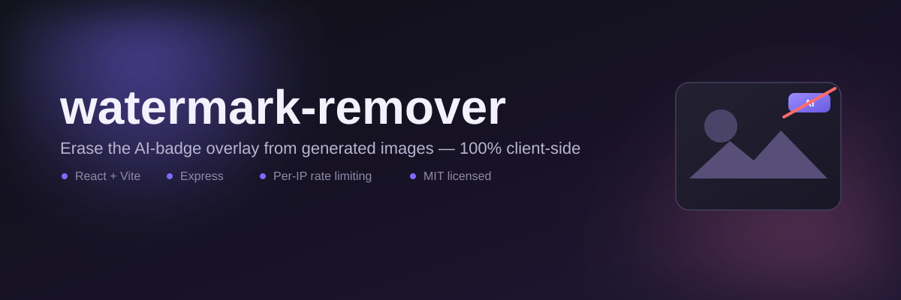
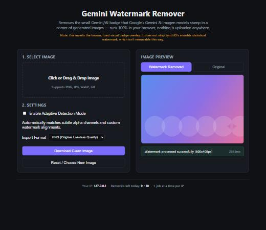

<p align="center">
  
</p>

<h1 align="center">watermark-remover</h1>

<p align="center">
  Remove the small AI-badge overlay that Google's Gemini &amp; Imagen models stamp onto
  generated images &mdash; entirely in your browser. Nothing is ever uploaded anywhere.
</p>

<p align="center">
  
  
  
</p>

---

## What this is

Images generated by Google's Gemini / Imagen models are sometimes stamped with a small,
fixed visual badge in a corner. This tool detects that badge's known size and alignment
and inverts it, restoring the pixels underneath &mdash; using the open-source
[`@pilio/gemini-watermark-remover`](https://github.com/GargantuaX/gemini-watermark-remover)
engine, running entirely in your browser's canvas. No image is ever sent to a server.

**Honesty note:** this removes the visible badge overlay. It does **not** strip
SynthID's invisible statistical watermark &mdash; that's a different, cryptographic
mechanism and isn't something a fixed-overlay inversion can touch.

This project is independent and not affiliated with or endorsed by Google.

## Screenshot

<p align="center">
  
</p>

## Features

- **Drag &amp; drop or click to upload** &mdash; PNG, JPG, WebP, GIF, up to 25MB
- **Adaptive detection mode** for subtle alpha channels and custom watermark alignment
- **Before / after preview** toggle
- **Export** as PNG (lossless), JPEG, or WebP
- **Live status footer** &mdash; shows your IP and remaining daily quota in real time via
  Server-Sent Events
- **Built-in abuse protection** &mdash; a small Express backend enforces, per IP:
  - a 10-removals-per-day quota (rolling 24h window)
  - only one job in flight at a time
  - a same-origin check on state-changing requests (CSRF protection)
  - a cap on concurrent live-status connections

## Tech stack

- **Frontend:** vanilla JS + Vite, calling the `@pilio/gemini-watermark-remover` browser SDK
- **Backend:** Express (Node, ESM) &mdash; serves the built frontend and a small rate-limiting
  API; all actual image processing stays client-side

## Getting started

```bash
npm install
npm run dev
```

Opens the app on `http://localhost:5181` (Vite) with the API on `:3001`, proxied together.

### Production build

```bash
npm run build     # -> dist/
npm start          # single process: serves dist/ + the API on $PORT (default 3001)
```

### Offline / standalone use

Don't want to run a server at all? The `standalone/` folder is a self-contained copy
of the app that runs straight from disk:

1. Download or clone the repo.
2. Open `standalone/index.html` in your browser (double-click it; `file://` works).

No `npm install`, no Node, no internet connection needed. It has the same features as
the web app (adaptive detection, before/after preview, PNG/JPEG/WebP export, 25MB limit),
minus the server parts: there is no daily quota and no live IP/quota footer. As in the
web app, images never leave your browser.

It works from `file://` because the app code and the `@pilio/gemini-watermark-remover`
engine are bundled into one classic script, `standalone/app.bundle.js` (browsers refuse
ES module imports under `file://`). The source is `standalone-src/main.js`; after
changing it, rebuild the bundle:

```bash
npx vite build --config vite.standalone.config.js
```

### Environment variables

| Variable      | Default | Purpose                                                                 |
|---------------|---------|--------------------------------------------------------------------------|
| `PORT`        | `3001`  | Port the server listens on (standard convention for most Node hosts)     |
| `TRUST_PROXY` | off     | Set to `1` **only** when running behind a trusted reverse proxy (e.g. a managed Node host that terminates TLS and forwards `X-Forwarded-For`). Enables reading the real visitor IP from that header instead of the raw socket address. Leave unset for a direct/local setup. |

## API

All endpoints are same-origin only; `/api/start` and `/api/finish` reject cross-origin
requests.

| Method | Path           | Purpose                                              |
|--------|----------------|-------------------------------------------------------|
| GET    | `/api/status`  | Current quota/lock state for your IP                  |
| GET    | `/api/stream`  | Server-Sent Events stream of live state for your IP    |
| POST   | `/api/start`   | Reserve a processing slot (enforces quota + lock)      |
| POST   | `/api/finish`  | Release the slot after a job completes                |

## License

[MIT](LICENSE) © 2026 AnshuvaGitrepo. Built on the MIT-licensed
[`@pilio/gemini-watermark-remover`](https://www.npmjs.com/package/@pilio/gemini-watermark-remover) engine.

<p align="center">
  <br>
  <sub>Prepared by Anshuva Samanta</sub>
</p>
